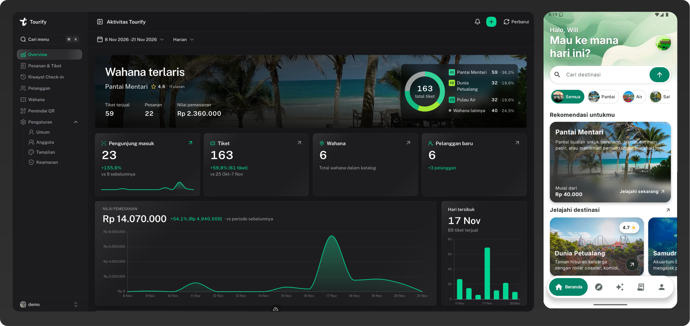
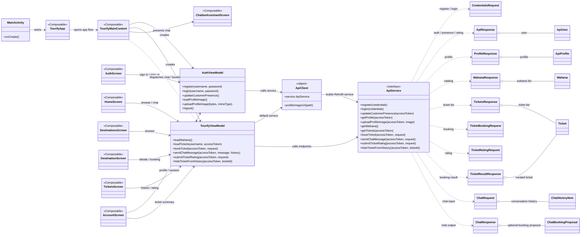

<p align="center">
  
</p>

<h1 align="center">Tourify</h1>

Tourify adalah platform pemesanan tiket wahana dengan aplikasi Android untuk pengunjung dan dashboard web untuk admin serta petugas. Proyek ini berisi aplikasi Android, dashboard Nuxt, API PHP, skema MySQL, dan berkas deploy.

## Fitur

### Aplikasi Android

- Daftar akun dan masuk.
- Jelajahi wahana, lihat detail, dan buka wahana unggulan dari Beranda.
- Pesan tiket dan tampilkan QR untuk proses kunjungan.
- Lihat sisa kuota tiket, riwayat kunjungan, dan status check-in.
- Beri rating setelah tiket memiliki check-in.
- Gunakan asisten chat untuk bertanya dan menyusun usulan pemesanan.
- Kelola profil dan foto akun.

### Dashboard web

- Kelola pesanan dan lihat jumlah pengunjung yang sudah check-in.
- Pindai QR tiket menggunakan kamera browser dan catat check-in per pengunjung.
- Lihat ringkasan aktivitas dan riwayat check-in.
- Buat, ubah, arsipkan, dan pilih wahana unggulan; unggah foto wahana.
- Akses dashboard memakai sesi login dengan peran admin atau petugas.

### API dan database

- API PHP menangani akun, katalog wahana, pemesanan, tiket, rating, check-in, dan dashboard.
- MySQL menyimpan akun, wahana, tiket, check-in, serta rating.
- Tiket dan riwayat check-in tetap tersimpan saat wahana diarsipkan.
- Chatbot dapat memakai `OPENAI_API_KEY` yang dikonfigurasi secara privat di server.

## Teknologi

<p align="center">
  
  
  
  
  
  
  
  
  
</p>

| Bagian | Teknologi |
| --- | --- |
| Android | Kotlin, Jetpack Compose, Navigation Compose, Retrofit |
| Dashboard | Nuxt, Vue, TypeScript, Nuxt UI |
| API | PHP 8.3, PDO MySQL |
| Database | MySQL |
| Hosting | Nginx dan PHP-FPM; panduan ada di [`deploy/README.md`](deploy/README.md) |

## Class diagram Android

Diagram berikut menunjukkan alur layar Compose, ViewModel, Retrofit API, dan model data utama.



## Struktur proyek

```text
app/                    Aplikasi Android
database/api/           Endpoint PHP dan panduan API/database
database/migrations/    Migrasi skema database
deploy/                 Konfigurasi dan panduan deploy VPS
web-dashboard/          Dashboard Nuxt
```

## Menjalankan secara lokal

### 1. Siapkan database dan API PHP

Gunakan PHP 8.3 dengan ekstensi `pdo_mysql`, `curl`, `mbstring`, `xml`, `gd`, dan `fileinfo`. Konfigurasi database dibaca dari `/etc/tourify/database.php` atau dari lokasi yang ditentukan oleh `TOURIFY_DB_CONFIG`. Contoh format konfigurasi tersedia di [`database/api/db.config.example.php`](database/api/db.config.example.php).

Untuk database pengembangan yang benar-benar baru, impor skema lalu data katalog:

```bash
mysql -u <pengguna_database> -p <nama_database> < database/schema.sql
mysql -u <pengguna_database> -p <nama_database> < database/seed.sql
```

Jalankan API pada alamat yang dapat dijangkau Android dan dashboard, dengan path dasar `/tourify-api/`. Untuk database yang sudah berisi data, baca [`database/api/README.md`](database/api/README.md) dan terapkan hanya migrasi yang belum pernah dijalankan.

### 2. Jalankan dashboard

Gunakan Node.js dan pnpm. Versi pnpm yang tercatat di `web-dashboard/package.json` adalah `12.15.0`.

```bash
cd web-dashboard
pnpm install --frozen-lockfile
pnpm dev
```

Dashboard berjalan di `http://localhost:3000`. Konfigurasi pengembangan Nuxt meneruskan `/tourify-api/` ke API PHP lokal di `http://127.0.0.1:8888/tourify-api/`; sesuaikan target proxy pada `web-dashboard/nuxt.config.ts` bila server lokal memakai alamat lain.

### 3. Jalankan aplikasi Android

Buka proyek ini di Android Studio, lalu pilih konfigurasi aplikasi `app`. Alamat dasar API Android dapat ditentukan dengan variabel lingkungan `TOURIFY_API_BASE_URL` atau properti lokal `tourifyApiBaseUrl` di `local.properties`:

```properties
tourifyApiBaseUrl=http://10.0.2.2:8888/tourify-api/
```

Alamat contoh tersebut memakai alias emulator Android untuk komputer pengembangan. Untuk perangkat fisik, gunakan alamat server yang dapat dijangkau perangkat melalui jaringan. `local.properties` tidak dilacak Git; jangan masukkan rahasia atau konfigurasi mesin ke source.

Build APK debug dari root proyek:

```bash
./gradlew assembleDebug
```

## Pemeriksaan proyek

```bash
# Tes unit Android
./gradlew testDebugUnitTest

# Tes Compose/instrumentasi Android; perlu emulator atau perangkat
./gradlew connectedDebugAndroidTest

# Pemeriksaan dashboard
cd web-dashboard
pnpm typecheck
pnpm lint
pnpm build
```

## Migrasi dan deploy

- [`database/api/README.md`](database/api/README.md) menjelaskan endpoint, konfigurasi server, foto, serta migrasi database.
- [`deploy/README.md`](deploy/README.md) menjelaskan persiapan VPS, HTTPS, dan pembaruan dashboard.
- Jangan mengimpor ulang `schema.sql` ke database berisi data dan jangan menjalankan migrasi yang sudah pernah diterapkan.
- Simpan kredensial database, `OPENAI_API_KEY`, sertifikat, dan kunci deploy di luar repository.
